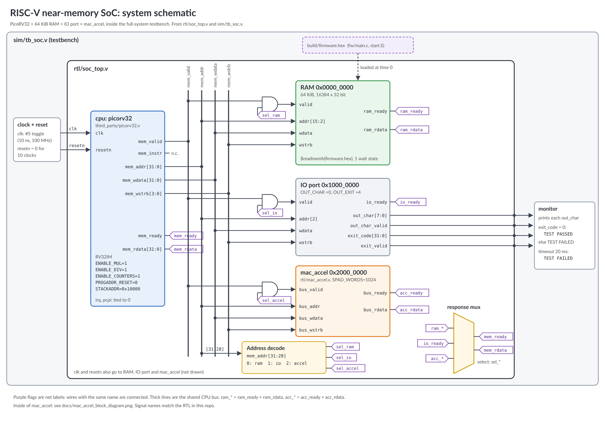
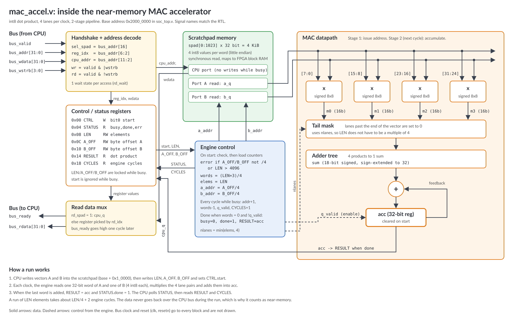

# Near-memory MAC accelerator for a RISC-V SoC

This is a small near-memory computing project. I connected an int8
dot-product (MAC) accelerator to a PicoRV32 RISC-V core. The accelerator has
its own scratchpad memory and reads the operands from there, so the data does
not go over the CPU bus during the computation.

The repo has the RTL, C firmware, cocotb tests with a Python reference model,
and a full-system simulation that compares the software result with the
accelerator result.

## Results

Simulation, dot product of two int8 vectors with 1024 elements:

| | Cycles | Result |
|---|---:|---:|
| Software on PicoRV32 (rv32im, hardware multiply) | 74,757 | 21,319 |
| Accelerator, compute only (seen from CPU) | 335 | 21,319 |
| Accelerator engine only | 258 | |
| Copy of both vectors into scratchpad | 13,073 | |

Compute only, the accelerator is about 223x faster. If I add the time to copy
the vectors into the scratchpad, it is about 5x. So most of the time goes in
moving the data. Note that PicoRV32 is a small multi-cycle core, so against a
pipelined CPU the speed-up would be lower.

## Diagrams

System schematic (CPU, RAM, IO port, accelerator, testbench):



Inside the accelerator:



Build and test flow: [docs/build_and_test_flow.png](docs/build_and_test_flow.png)

## Files

- `rtl/mac_accel.v` - the accelerator. 2-stage pipeline, 4 int8 lanes per
  cycle. It masks the extra lanes when the length is not a multiple of 4, and
  sets an error flag for a misaligned offset or a LEN that is too big.
  Register map is at the top of the file.
- `rtl/soc_top.v` - PicoRV32, RAM, accelerator and an output port.
- `fw/main.c` - does the dot product in software and on the accelerator,
  prints both results and cycle counts, and fails if they are different.
- `tests/test_mac_accel.py` - cocotb tests: known values, int8 min/max,
  lengths that are not a multiple of 4 (with junk left in the scratchpad),
  error cases, scratchpad read-back, and 60 random runs checked against the
  Python model. The random test also checks the cycle count and prints a
  small functional coverage table.
- `sim/tb_soc.v` - testbench for the full system.

## How to run

You need Icarus Verilog, Verilator (only for lint), cocotb and a RISC-V GCC.
All are free. I used Ubuntu on WSL (Windows):

```
sudo apt-get install iverilog verilator gcc-riscv64-unknown-elf
pip install cocotb
make test
```

`make test` runs the lint, the cocotb tests and the full-system simulation.
GitHub Actions runs the same on every push (`.github/workflows/ci.yml`).

## To do

- [ ] SystemVerilog assertions for the bus handshake and the engine (bind file)
- [ ] Code coverage with Verilator
- [ ] Double buffering, so the CPU can load the next vectors while the engine runs
- [ ] FPGA board, with LUT/DSP/BRAM usage and Fmax (see `fpga/README.md`)
- [ ] Run a real int8 layer, e.g. the small MLP from my
      [cgm-forecasting-tinyml](https://github.com/madihaanjumshahzad-creator/cgm-forecasting-tinyml) repo
- [ ] Fault injection in the scratchpad with a parity/ECC check

## Credits

PicoRV32 is by Claire Xenia Wolf and contributors (ISC license), taken from
https://github.com/YosysHQ/picorv32 at commit `ef203c2`.
The rest is MIT license, (c) 2026 Madiha Anjum.
